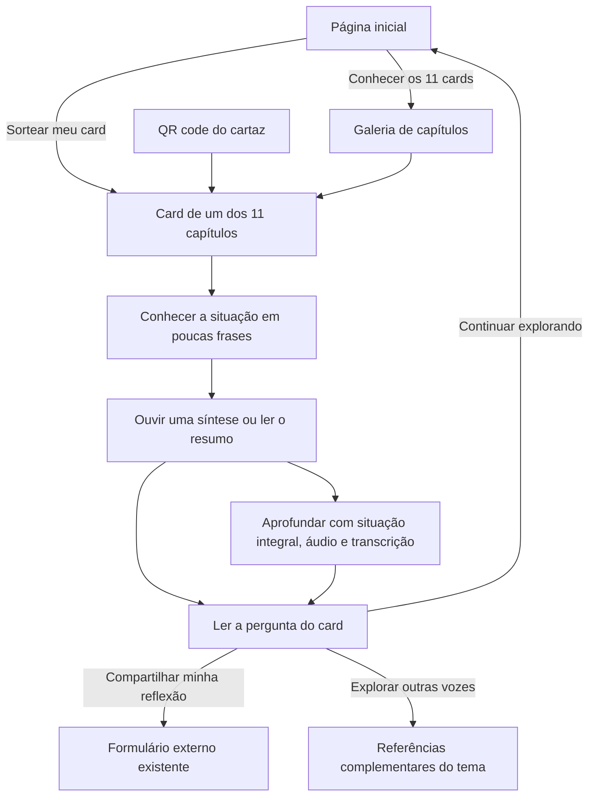

# Plano do site — Calendário Consciente

Planejamento preparado em 03/11/2026 para o projeto **Pequenas Escutas, Grandes Reflexões — Faculdade Senac Portão**.

## Objetivo

Criar uma experiência de letramento racial a partir dos mesmos 11 cards já produzidos: reconhecer situações de racismo no cotidiano, ouvir uma reflexão autoral da equipe e pensar em possibilidades de ação antirracista.

O site deve preservar o material aprovado e tornar seu conteúdo utilizável no celular, tanto por quem chega pela internet quanto por quem lê um QR code do material impresso.

## Decisões confirmadas com o usuário

- A entrada principal oferece **sorteio de um card**.
- O QR code do cartaz abre **diretamente o capítulo correspondente**.
- As reflexões são enviadas pelo **Microsoft Forms já usado nos cartazes**.
- O site reúne os mesmos temas, situações e perguntas das 11 imagens.
- A identidade visual parte do convite anexado à conversa e dos cards existentes: creme, verde escuro, amarelo, laranja, formas orgânicas e ilustrações já produzidas.
- **Djamila Ribeiro permanece como referência principal**. Criadores negros, comunicadores antirracistas e organizações negras entram como referências complementares relacionadas ao tema de cada card.
- A experiência deve acolher também quem prefere vídeo curto, áudio acelerado e leitura breve, oferecendo escolhas de formato e aprofundamento.

O detalhamento dessa atualização e a pesquisa inicial de referências estão em [CURADORIA-E-ENGAJAMENTO.md](CURADORIA-E-ENGAJAMENTO.md).

Este documento cobre o planejamento. A implementação das páginas, a preparação dos arquivos de áudio e a publicação são as etapas seguintes.

## Jornada



Ler, ouvir e continuar explorando são possíveis sem responder ao formulário. A reflexão é voluntária e não depende de terminar a reprodução do áudio.

## Páginas e comportamento

### Página inicial

1. Nome da ação, identificação da Faculdade Senac Portão e apresentação curta do propósito de letramento racial.
2. Explicação em três passos: receba um card, escolha ler ou ouvir e compartilhe sua percepção.
3. Botão principal **Sortear meu card**.
4. Acesso complementar **Conhecer os 11 cards**, com título, número e imagem de cada capítulo.
5. Informação de autoria dos áudios e referência ao material que inspira a ação, conforme os créditos existentes.

O sorteio leva a uma das URLs reais dos capítulos. Na mesma sessão, o botão **Sortear outro card** prioriza os ainda não sorteados; após os 11, começa um novo ciclo e informa isso. A lista de sorteados pode ficar em `sessionStorage`, sem identificação da pessoa. Se esse recurso estiver indisponível, o sorteio continua funcionando. Abrir um QR nunca provoca sorteio nem substitui o capítulo solicitado.

Não haverá desbloqueio por data: os 11 capítulos ficam disponíveis. O nome Calendário Consciente, por si só, não exige uma sequência diária.

### Página de capítulo

Manter `/c1/index.html` até `/c11/index.html`, inclusive acesso por `/cN/` quando suportado pela hospedagem. Cada página contém, nesta ordem:

1. Número, título e uma situação resumida em poucas frases, sem exigir percorrer o cartaz inteiro para começar.
2. Opções **Ouvir uma síntese** e **Ler o resumo**, quando a adaptação curta estiver pronta. O alvo inicial de 30–60 segundos é uma hipótese de formato para testar, não uma promessa de aprendizagem nesse tempo.
3. Pergunta **Para refletir**, preservando a pergunta do card, e botão **Compartilhar minha reflexão**, acompanhado de “Você será direcionado ao formulário da ação”.
4. Área de aprofundamento com situação integral em HTML, imagem original otimizada com opção de ampliar, áudio completo e transcrição correspondente. Um resumo não substitui a transcrição.
5. Bloco opcional **Outras vozes sobre este tema**, depois do convite à reflexão, com até duas indicações contextualizadas e links originais.
6. Ações complementares **Sortear outro card** e **Ver todos os cards**.

O player informa qual versão está sendo ouvida, sua duração e posição. Começa em 1×, somente por ação da pessoa, e permite escolher 0,75×, 1,25×, 1,5× ou 2×. Acelerar é uma preferência da pessoa. Manter reprodução, pausa, retrocesso, operação por teclado e acesso à transcrição.

A navegação para outro capítulo interrompe o áudio anterior. Quando não houver arquivo aprovado, mostrar **Áudio em preparação** e oferecer o texto revisado; nunca apontar para uma gravação de teste como se fosse definitiva. A opção de síntese em áudio aparece apenas quando houver arquivo próprio revisado; não criar um falso resumo cortando a reprodução do áudio completo.

Os vídeos externos são complementares. Na primeira versão, usar links identificados por criador, plataforma, tema e motivo da indicação. O conteúdo essencial continua acessível dentro do site, mesmo que uma rede social exija login ou remova uma publicação. Não incluir feed automático de redes sociais.

### Formulário externo

Usar o endereço decodificado dos QR codes existentes, registrado em [INVENTARIO-DE-CONTEUDO.md](INVENTARIO-DE-CONTEUDO.md).

- Exibir o número e o título do card ao lado do botão, para que a pessoa saiba a qual situação está respondendo.
- Abrir o formulário em uma nova aba, avisando no texto do link e preservando a página do capítulo.
- Conferir os campos e as permissões atuais antes do lançamento: acesso do público previsto, identificação opcional ou obrigatória e existência de uma pergunta sobre o capítulo.
- Usar preenchimento prévio do capítulo somente se o Forms oferecer um link válido para o formulário atual. Não criar parâmetros por suposição.
- Caso o formulário não identifique o capítulo, registrar com a equipe a necessidade de acrescentar essa pergunta; até isso ser resolvido, não afirmar que as respostas estarão separadas por card.
- Não apresentar no site a mensagem “Resposta enviada”: a confirmação de envio pertence ao Forms. Abrir o link não comprova envio.
- O site não coleta texto de resposta, nome ou e-mail, não guarda respostas em armazenamento local e não publica um mural de depoimentos.
- Não prometer anonimato sem conferir as configurações do formulário existente.

## Conteúdo e orientação editorial

O inventário contém os 11 títulos e as perguntas existentes. A situação deve ser transcrita integralmente do card final, com conferência visual; os resumos do inventário servem para organização, não substituem o material aprovado.

Cada capítulo terá um único registro de conteúdo, com: `id`, `titulo`, `situacao`, `resumo`, `pergunta`, `imagem`, `imagemAlt`, `audio`, `transcricao`, `statusAudio` e `creditos`. Campos opcionais `audioCurto`, `transcricaoCurta`, `acaoSugerida` e `referenciasComplementares` organizam as adaptações e a curadoria. A URL do formulário fica em uma configuração comum. A página inicial e as páginas dos capítulos usam o mesmo catálogo para evitar títulos, perguntas ou arquivos trocados.

Os áudios são reflexões com palavras próprias da equipe. Manter os créditos da ação e da inspiração em *Pequeno Manual Antirracista*, de Djamila Ribeiro, como nos materiais existentes. Não transformar os capítulos em reprodução do livro.

Identificar os resumos como adaptações autorais da equipe. Os demais criadores aparecem com o crédito de seus próprios conteúdos, sem sugerir que escreveram os cards ou participam da ação. A seleção é temática, não determinada pelo número de seguidores. Diferenciar criadores individuais de organizações do movimento negro; não presumir filiação formal de uma pessoa.

As perguntas devem manter o foco no racismo e nas atitudes antirracistas, sem reduzir a ação a uma mensagem genérica de convivência. A experiência não terá notas, classificação de participantes ou obrigação de relatar vivências pessoais. Respostas não serão publicadas automaticamente.

**Correção editorial necessária:** o roteiro do capítulo 7 no documento completo trata de piadas e expressões racistas, enquanto o card é **Leia autores negros**. O texto e a transcrição desse capítulo precisam ser alinhados ao card antes de gravar ou publicar como conteúdo final.

## Base técnica

Usar a estrutura estática já presente no clone: **HTML, CSS e JavaScript**, com estilos, catálogo e comportamentos compartilhados. O formulário externo permite manter esse desenho sem banco de dados ou servidor de respostas no site. O [GitHub Pages publica arquivos estáticos de um repositório](https://docs.github.com/en/pages/getting-started-with-github-pages/what-is-github-pages).

Organização prevista:

```text
index.html
c1/index.html ... c11/index.html
assets/
  css/site.css
  js/conteudo.js
  js/inicio.js
  js/capitulo.js
  imagens/                 # derivados leves para a web
  audio/                   # gravações finais, quando aprovadas
docs/
  PLANO-DO-SITE.md
  INVENTARIO-DE-CONTEUDO.md
```

Os dois arquivos de áudio existentes podem permanecer nos caminhos atuais até sua identificação e eventual substituição controlada. Não mover arquivos apenas para adequar a árvore proposta.

Todos os caminhos devem funcionar sob o prefixo de projeto da hospedagem, sem assumir que o site está na raiz do domínio. As rotas impressas dos capítulos têm prioridade sobre a organização interna dos arquivos.

As 11 imagens finais somam 256.201.061 bytes. Produzir derivados para a web, manter os originais intactos e carregar imagens dos capítulos sob demanda. A imagem ampliada também deve ser uma versão adequada à web. Não carregar os 11 áudios na página inicial.

## Estado do repositório e hospedagem

Clone localizado em:

```text
C:\Users\11176\OneDrive - Senac PR\Área de Trabalho\c-con
```

O remoto configurado é `https://github.com/maidell/c-con.git`, e `git ls-remote` confirmou acesso ao `main`. A pasta local e o remoto ainda usam o nome `c-con`.

O material impresso aponta para `https://maidell.github.io/calendario-consciente/cN/index.html`. Na inspeção de 03/11/2026, o capítulo 1 nesse endereço retornou HTTP 200 e a página de teste de áudio; o mesmo capítulo em `/c-con/` retornou HTTP 404. Não assumir que alterar o nome da pasta ou o endereço publicado é necessário. Antes de publicar, confirmar qual configuração/repositório alimenta o endereço já impresso e manter sua continuidade.

Situação encontrada antes deste planejamento:

- Página inicial com os 11 links.
- `c1/index.html` e `c2/index.html` com players de teste.
- `c3/index.html` a `c11/index.html` vazios.
- Áudios em `c1/Gravando.m4a` e `c2/ab.m4a`, ainda sem correspondência de conteúdo confirmada.
- Mudanças locais anteriores em `c2`: exclusão de `aa.m4a`, inclusão de `ab.m4a` e ajuste da página. Preservar essas mudanças.

## Sequência de implementação

1. **Consolidar conteúdo:** transcrever as situações e perguntas das 11 imagens finais, extrair os roteiros autorais, corrigir a divergência do capítulo 7 e identificar os dois áudios de teste. Conferir os campos do Forms e a origem da hospedagem atual.
2. **Preparar identidade e arquivos:** produzir imagens leves e definir tipografia legível, cores, espaçamento, foco e componentes a partir do material existente. Redigir entradas curtas que preservem uma ideia central, um exemplo e uma possibilidade de ação.
3. **Montar a navegação:** criar a página inicial, a galeria e o sorteio, preservando os 11 endereços de capítulo.
4. **Montar a experiência de capítulo:** integrar resumo, situação integral, imagem, player com velocidade selecionável, transcrição, pergunta e link do Forms. Usar um capítulo como referência e aplicar o mesmo modelo aos demais.
5. **Integrar as gravações finais:** conferir associação, inteligibilidade, volume, duração e correspondência com cada transcrição. Enquanto faltarem gravações, manter o estado de preparação visível na prévia.
6. **Testar o formato curto e a curadoria:** começar pelos capítulos 1, 6 e 8, com sínteses autorais e até duas referências específicas por tema, após revisão das publicações. Observar se participantes compreendem a ideia central e conseguem apontar uma atitude possível; ajustar o formato antes de expandir as sínteses em áudio aos demais capítulos.
7. **Validar e publicar no endereço compatível:** testar fluxo completo e QR codes antes de disponibilizar a ação ao público.

As etapas de layout e navegação podem avançar enquanto os áudios são preparados. O lançamento completo depende dos 11 conteúdos e áudios revisados e da confirmação do destino dos QR codes.

As sínteses adicionais em áudio e os vídeos complementares podem entrar gradualmente. Sua ausência não deve impedir o acesso ao material integral dos 11 cards. A primeira versão oferece resumo em texto e acesso claro à reflexão completa em todos os capítulos.

## Critérios de aceitação

- Os 11 capítulos têm título, situação, imagem, pergunta, áudio final e transcrição correspondentes ao material revisado.
- O sorteio contempla os 11 cards e respeita a regra de repetição na sessão; abrir um QR sempre mantém o capítulo indicado.
- Os 11 links de áudio impressos são verificados no endereço público, sem páginas vazias ou erros.
- O formulário externo abre pelo botão e pelo QR existente; a identificação do capítulo e as condições de participação estão verificadas.
- O site não apresenta confirmação falsa de envio nem pressupõe anonimato do Forms.
- Leitura, reprodução e navegação funcionam em celular e computador; testar teclado, leitor de tela, foco visível e ampliação de texto.
- O conteúdo essencial existe em HTML; a imagem não é a única maneira de ler a situação e a pergunta.
- O topo de cada capítulo oferece uma entrada breve; os textos integrais e os créditos permanecem acessíveis.
- Resumo e transcrição são identificados separadamente; as versões curta e completa do áudio, quando presentes, não se confundem.
- A velocidade começa em 1× e pode ser alterada pela pessoa; nenhuma mudança de ritmo ocorre automaticamente.
- As referências complementares têm autoria, relação com o tema e origem verificadas. Um link de perfil é identificado como perfil; só apresentar um vídeo como indicação específica depois de revisar sua publicação.
- O piloto considera compreensão e possibilidade de ação, além do interesse em continuar. Cliques ou tempo de reprodução não são tratados como prova de letramento racial.
- Player e transcrição funcionam com áudio disponível; erro de reprodução apresenta mensagem clara e preserva a leitura.
- Não há reprodução automática, rolagem horizontal ou carregamento antecipado de todos os áudios.
- Os créditos e o nome **Faculdade Senac Portão** correspondem às versões finais.
- A validação final inclui um envio de teste identificado como tal pela equipe responsável no Forms, sem publicar respostas reais.

## Próxima entrega

Uma prévia navegável da página inicial e do modelo de capítulo, já conectada ao catálogo dos 11 cards e ao Forms existente, com entrada breve, aprofundamento e espaço para outras vozes. O estado dos áudios deve ser explícito até que cada gravação esteja revisada. A entrega desta etapa é o planejamento, o inventário e a proposta de curadoria; nenhuma página de produção foi alterada por estes documentos.

## Prévia local implementada — 03/11/2026

A primeira versão navegável foi preparada no próprio clone, com os 11 cards, sorteio, imagens leves, leituras completas em texto, referências por perfil e Forms externo. Os capítulos 1, 6 e 8 têm leituras em voz automática de 40–47 segundos, explicitamente identificadas como prévia, com velocidade selecionável e transcrição correspondente. As gravações finais da equipe continuam pendentes.

O capítulo 7 recebeu uma nova proposta autoral coerente com “Leia autores negros”, registrada no catálogo para revisão editorial. As páginas antigas de teste e suas gravações foram preservadas em `c1/teste-audio.html` e `c2/teste-audio.html`.

A inspeção do formulário confirmou um ponto a resolver: há apenas duas alternativas provisórias e nenhum campo para escrever a reflexão. A prévia informa esse estado; os ajustes estão em [CONFIGURAR-FORMULARIO.md](CONFIGURAR-FORMULARIO.md). Nenhuma resposta foi enviada e nenhuma configuração do Forms foi modificada.

Executar `npm run dev` para abrir a prévia local. Não houve publicação nem push desta implementação.
